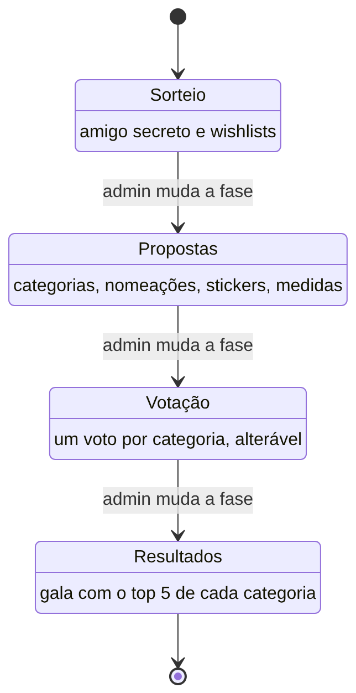

# 1. O negócio

## Em resumo

Os **Canhões do Ano** são o ritual anual de um grupo de amigos: um amigo secreto com troca de presentes e uma gala de prémios humorísticos ("canhões") votados pelo grupo. A app é o portal privado onde tudo isso acontece ao longo de algumas semanas, do sorteio à gala.

É um negócio simples: um grupo fechado (dezenas de pessoas, não milhares), um evento por ano, e um ou dois admins que conduzem o calendário.

## Atores

| Ator | Quem é | O que pode fazer |
|---|---|---|
| **Visitante** | Qualquer pessoa sem sessão | Só vê o login e, com um link de convite, a página de registo |
| **Convidado** | Alguém com um convite aberto para o seu email | Cria conta (Google ou email + password) e entra no evento do convite |
| **Membro** | Utilizador inscrito no evento (`EventMember`) | Usa os módulos que a fase atual abre: mural, wishlist, propostas, votação, gala |
| **Admin** | Utilizador com `User.isAdmin` | Tudo o que um membro faz, em qualquer fase, mais a gestão do evento |

Os emails em `ADMIN_EMAILS` tornam-se admins no seed. Fora de produção existe ainda o login de desenvolvimento, que entra automaticamente como admin.

## O ciclo anual

Cada edição é um `Event`. O admin ativa um evento de cada vez e faz avançar as fases à mão; um evento novo começa em PROPOSALS e as outras fases são criadas quando o admin as abre.

1. **Sorteio (`DRAW`).** Os membros preenchem a wishlist. O admin sorteia o amigo secreto, pode repetir o sorteio as vezes que quiser e, quando estiver satisfeito, revela-o. A partir daí cada membro vê a quem dá o presente e a wishlist dessa pessoa.
2. **Propostas (`PROPOSALS`).** Os membros propõem categorias de prémio, nomeiam momentos para as categorias, submetem stickers e propõem medidas para a gala. O admin aprova ou rejeita cada proposta.
3. **Votação (`VOTING`).** Cada membro escolhe uma opção por categoria ativa e pode mudar de ideias enquanto a votação estiver aberta. Há dois tipos de categoria: voto num momento nomeado, ou voto numa pessoa do grupo.
4. **Resultados (`RESULTS`).** A gala mostra, por categoria, os 5 mais votados com o número de votos.

O mural (feed) está aberto em todas as fases, para posts, fotos, sondagens, comentários e reações.

## Módulos

Cada área da app é um módulo. O admin pode desligar qualquer um; os que estão ligados só aparecem na fase em que servem para alguma coisa (regra RN-04 em [02-requisitos.md](02-requisitos.md)). A navegação é igual para todos: o mural, as duas primeiras áreas abertas e o botão de post ficam na barra de baixo, e o resto no menu. O admin tem ainda o separador Admin, onde abre qualquer área, mesmo fechada, em Admin › Evento.

| Módulo | Rota | Para quê |
|---|---|---|
| `feed` | `/canhoes` | Mural social: posts com até 4 imagens, sondagens, comentários com respostas, reações, likes |
| `secretSanta` | `/canhoes/amigo-secreto` | A quem dou o presente, depois de o admin revelar o sorteio |
| `wishlist` | `/canhoes/wishlist` | Lista de desejos de cada membro, visível ao grupo |
| `categories` | `/canhoes/categorias` | Propor categorias novas |
| `nominees` | `/canhoes/nomeacoes` | Nomear alguém para uma categoria e ver as nomeações aprovadas |
| `stickers` | `/canhoes/stickers` | Submissão de stickers (nomeações do tipo sticker) |
| `measures` | `/canhoes/medidas` | Medidas da gala e propostas de medidas |
| `voting` | `/canhoes/votacao` | Boletim de voto |
| `gala` | `/canhoes/gala` | Resultados oficiais |
| `admin` | `/canhoes/admin` | Painel do admin: Resumo, Conteúdo (moderação, categorias, resultados), Membros (convites, sorteio) e Evento (evento ativo, fase, propostas e todas as áreas) |

## Glossário

| Termo | Significado |
|---|---|
| Canhão | Prémio humorístico atribuído na gala |
| Evento / edição | Um ano dos Canhões (`Event`); só um está ativo |
| Fase | Etapa do ciclo anual (`EventPhase.type`) |
| Categoria | Um prémio a votar (`AwardCategory`); `kind = 0` vota em nomeações, `kind = 1` vota em pessoas |
| Nomeação | Um candidato proposto para uma categoria (`Nominee`), também usado para stickers |
| Medida | Regra ou "lei" da gala (`GalaMeasure`), proposta pelos membros (`MeasureProposal`) |
| Sorteio | Atribuição do amigo secreto (`SecretSantaDraw` + `SecretSantaAssignment`) |
| Revelar | Trancar o sorteio (`isLocked`) e mostrá-lo aos membros; não pode ser repetido depois |
| Mural / feed / hub | Rede social interna (`HubPost*`) |
