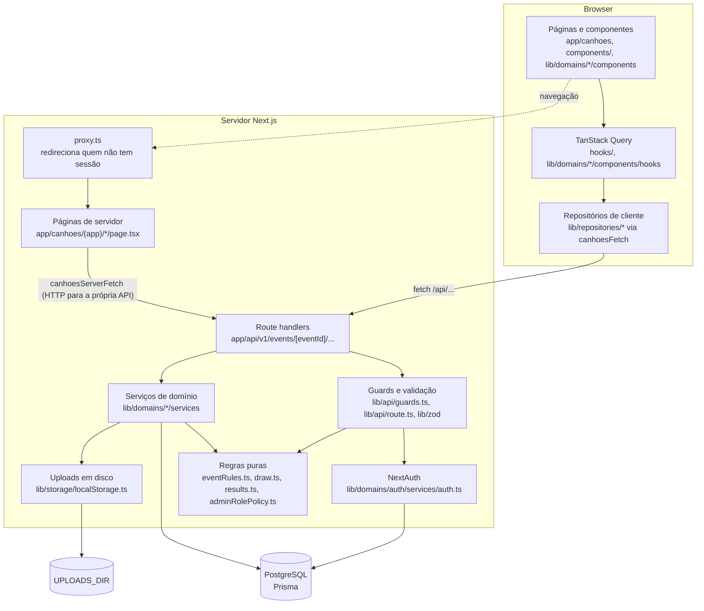
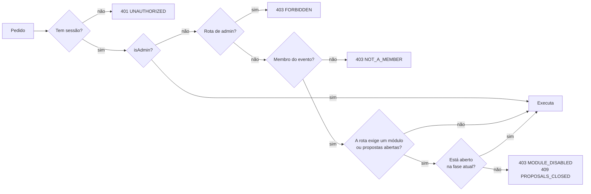

# 3. Arquitetura

## Visão geral

Uma única aplicação Next.js 16 (App Router) serve as páginas e a API. Não há backend separado: os route handlers em `app/api` falam com o PostgreSQL através do Prisma.



## Camadas

| Camada | Onde | Responsabilidade |
|---|---|---|
| Páginas | `app/canhoes/(app)`, `app/canhoes/(public)` | Rotas da UI. `(public)` tem o login e o registo; `(app)` precisa de sessão. |
| Componentes | `components/`, `lib/domains/*/components` | UI. `components/ui` são primitivas (shadcn/Radix); `components/chrome` é o layout (header, barra de baixo, menu). |
| Estado de cliente | `lib/domains/*/hooks` | TanStack Query. Depois de uma escrita invalida as queries em vez de copiar estado. |
| Textos | `messages/pt.json` | Todo o texto visível, por funcionalidade e componente (ver abaixo). |
| Repositórios de cliente | `lib/repositories/*` | Uma função por endpoint, sobre `canhoesFetch` (`lib/api/canhoesClient.ts`). |
| Route handlers | `app/api/**/route.ts` | Finos e todos iguais: guard, validação, uma chamada ao serviço. |
| Guards e validação | `lib/api/guards.ts`, `lib/api/route.ts`, `lib/zod/*` | Quem pode chamar; o que o corpo tem de conter. |
| Serviços | `lib/domains/<domínio>/services` | Lógica de negócio e acesso à base de dados com Prisma. |
| Regras puras | `lib/domains/*/rules`, `draw.ts`, `results.ts`, `adminRolePolicy.ts`, `signInAccess.ts` (`decideSignIn`) | Decisões sem I/O, testadas com testes unitários. As de `rules/` também correm no cliente. |
| Tipos partilhados | `lib/api/types.ts` | DTOs que o servidor devolve e o cliente consome. |

### Organização de uma funcionalidade

Cada funcionalidade (`admin`, `auth`, `categories`, `event`, `feed`, `gala`, `measures`,
`secretSanta`, `stickers`, `stories`, `voting`, `wishlist`) tem uma pasta em `lib/domains/<funcionalidade>/`
com as mesmas subpastas:

```text
lib/domains/<funcionalidade>/
  components/   UI. <Funcionalidade>Module.tsx é a entrada que a página monta.
  hooks/        use<Recurso>.ts: queries, mutações e estado de ecrã.
  rules/        funções puras (sem I/O, sem React) com testes; podem correr no cliente.
  services/     Prisma, só no servidor.
```

As páginas em `app/canhoes/**/page.tsx` só buscam os dados iniciais e montam o módulo.

Quem pode importar o quê (`import/no-restricted-paths` no `eslint.config.mjs`, falha o lint):

- `components/ui` não conhece domínios nem o shell.
- Uma funcionalidade não importa a UI (`components/`, `hooks/`) de outra; pode usar `event`, que
  é a partilhada (gate, header de módulo, overview), e o `rules/` de qualquer outra.
- Código de cliente nunca importa `services/`. Para além do lint, `lib/prisma.ts` importa
  `server-only`, e o build falha se o Prisma chegar a um bundle de cliente.
- `lib/` não importa `app/`.

Tamanho e complexidade (falham o lint fora do código de servidor): ficheiros até 250 linhas,
funções até 80, complexidade ciclomática até 10, cognitiva até 15 (`eslint-plugin-sonarjs`),
aninhamento até 3 e até 4 parâmetros. Quando um componente passa os limites, parte-se assim:

- o **módulo** compõe a página e escolhe entre carregar, erro, vazio e conteúdo;
- os **hooks** fazem I/O e guardam o estado;
- as **funções puras** (updaters de cache, validação, ordenação) vão para `rules/` ou para um
  `.ts` junto do hook, com teste unitário;
- os **componentes de apresentação** só recebem props e callbacks `on<Ação>`.

Convenções:

- Componentes exportados têm nomes que descrevem o papel visual (`CategoryEditorDrawer`).
- Constantes de domínio substituem números mágicos e labels duplicadas.
- Estado derivado em vez de `useEffect` a sincronizar estado (ex.: a categoria selecionada é a
  escolhida, se ainda existir, ou a primeira).
- Comentários explicam intenção, limitações externas ou decisões não óbvias.
- Depois de uma mutação, a invalidação usa exatamente o prefixo da query que foi carregada.
- Erros são registados numa transição de estado ou num handler, nunca a cada render.

### Textos

Todo o texto visível (labels, placeholders, `aria-label`, toasts, estados vazios e de erro) vive
em `messages/pt.json`, por funcionalidade e depois por componente: `feed.HubPostCard.closeComments`
é usado em `HubPostCard`. Para encontrar o componente de um texto do ecrã, procura o texto no JSON;
o caminho da chave diz onde está.

```ts
import messages from "@/messages/pt.json";
import { formatMessage } from "@/lib/messages";

const copy = messages.feed.HubPostCard;
formatMessage(copy.commentCount, { count }); // "{count} comentários"
```

O import do JSON é tipado (`resolveJsonModule`), por isso uma chave errada falha no `tsc`.
Os placeholders seguem o formato ICU (`{nome}`), o mesmo do `next-intl`, se um dia houver outra
língua. Texto partilhado vai para `common.*`. `react/jsx-no-literals` impede texto escrito
diretamente no JSX.

### Testes

| Tipo | Ficheiros | Comando |
|---|---|---|
| Unitários (lógica pura) | `**/*.test.ts` | `npm test` |
| Componentes e hooks (jsdom + Testing Library) | `**/*.test.tsx` | `npm run test:component` |
| Integração (route handlers + PostgreSQL) | `tests/integration/**/*.int.test.ts` | `npm run test:integration` |

`npm run test:coverage` junta os três numa só medição (o job de integração do CI corre-o e falha abaixo dos mínimos). Os mínimos em `vitest.config.mjs` só sobem: depois de cada lote de testes, acerta-os logo abaixo dos números novos, até 90% de linhas e de branches.

Os testes de componentes testam o que o utilizador vê e faz (texto, papéis, cliques), não a
implementação. A API é simulada na rede com MSW, por isso o código corre como em produção, desde o
repositório até ao `canhoesFetch`. Os helpers ficam em `tests/component/`:

| Ficheiro | Para quê |
|---|---|
| `server.ts` | O servidor MSW. Um pedido sem handler faz falhar o teste. |
| `api.ts` | `apiRoute(método, caminho, corpo, estado)` para responder e `recordRequests()` para verificar o que a UI enviou. |
| `fixtures.ts` | Construtores de DTOs com valores por omissão (`category()`, `nominee()`, `post()`…). |
| `eventContext.ts` | `makeEventContext({ phaseType, modules, isAdmin })`: um evento ativo como o shell o recebe. |
| `session.ts` | `signInAs()`/`signOutUser()` e os mocks de `signIn`/`signOut` do `next-auth/react`. |
| `navigation.ts` | `setNavigation({ pathname, search })` e o `router` simulado de `next/navigation`. |
| `renderWithProviders.tsx` | Renderiza com um `QueryClient` novo, o `AuthProvider` real e os toasts. |

Os testes de integração usam `tests/integration/helpers.ts`: `callRoute` chama um route handler como
o Next.js, `signInAs` escolhe a sessão, e `createEvent`/`createMember`/`createUser` criam os dados.



Os guards (`lib/api/guards.ts`) aplicam este fluxo: `requireUser`, `requireAdmin`, `requireEventAccess`, `requireModule` e `requireProposalsOpen`. A matriz em `tests/integration/authorization.int.test.ts` descobre todas as rotas da API e verifica cada uma contra visitante, utilizador fora do evento, membro e admin.

## Organização das pastas

```text
app/
  api/                 route handlers (API REST)
  canhoes/(public)/    login e registo
  canhoes/(app)/       páginas autenticadas, uma pasta por módulo
components/
  ui/                  primitivas (shadcn/Radix)
  chrome/              layout: header, barra de baixo, menu
  providers/           sessão, React Query, toasts
lib/
  api/                 cliente HTTP, guards, apiRoute, tipos
  domains/<funcionalidade>/   components/, hooks/, rules/ e services/
  repositories/        chamadas à API a partir do cliente
  storage/             uploads em disco
  zod/                 schemas de validação
messages/pt.json       todos os textos da UI
prisma/                schema, migrations e seed
tests/component/       setup e helpers dos testes de componentes
tests/integration/     testes contra PostgreSQL real
docs/                  esta documentação
```

## Aspeto: a "Caderneta de Cromos"

O sistema visual está descrito em `DESIGN.md` (na raiz); aqui ficam só as regras que o código impõe:

- Os tokens vivem em `app/globals.css`; nunca se escrevem cores à mão nos componentes.
- Cada pessoa tem uma cor (`User.color`, uma de `lib/personColors.ts`, sorteada ao criar a conta e mudada no menu) e cada área tem a sua (`--area-*`). `CanhoesChrome` põe a cor da área atual em `--area` (tipado em `lib/react-css.d.ts`) e os componentes leem `var(--area, var(--moss))`.
- O verde (`--moss`) é só para a fase, a ação principal e o que está "colado" (estado concluído). Texto sobre cor usa `--on-moss` ou `--on-person`.
- Estados são marcas impressas: lugar vazio tracejado (`EmptyState`, o lugar "Cola aqui o teu post"), lugar preenchido a verde sólido (opção votada, `aria-pressed`).
- Cada post tem um número (`postNumber`), calculado no servidor pela data de criação, por isso não muda ao fazer scroll.
- Listas de membros partilham uma só query (`useEventMembers`).
