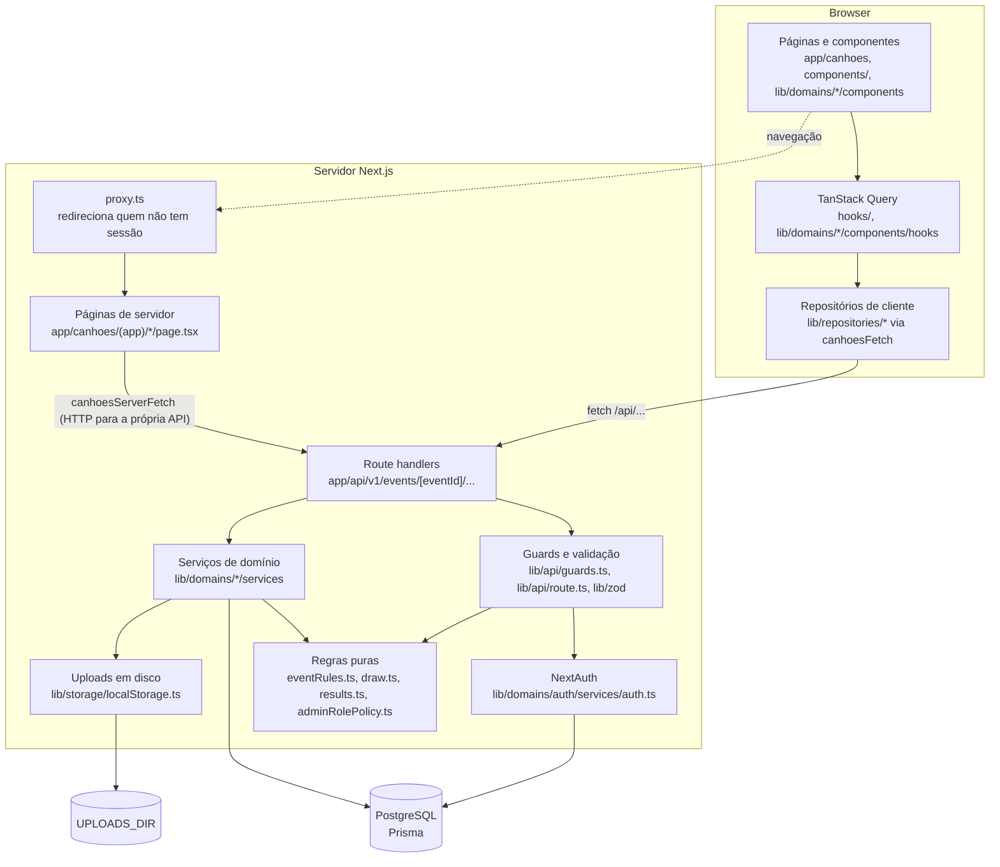
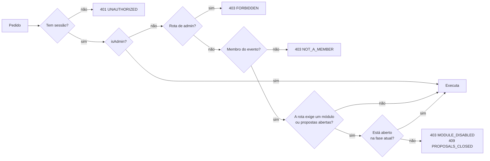

# 3. Arquitetura

## Visão geral

Uma única aplicação Next.js 16 (App Router) serve as páginas e a API. Não há backend separado: os route handlers em `app/api` falam com o PostgreSQL através do Prisma.



## Camadas

| Camada | Onde | Responsabilidade |
|---|---|---|
| Páginas | `app/canhoes/(app)`, `app/canhoes/(public)` | Rotas da UI. `(public)` tem o login e o registo; `(app)` precisa de sessão. |
| Componentes | `components/`, `lib/domains/*/components` | UI. `components/ui` são primitivas (shadcn/Radix); `components/chrome` é o layout (navegação, header, compose). |
| Estado de cliente | `hooks/`, `lib/domains/*/components/hooks` | TanStack Query. Depois de uma escrita invalida as queries em vez de copiar estado. |
| Repositórios de cliente | `lib/repositories/*` | Uma função por endpoint, sobre `canhoesFetch` (`lib/api/canhoesClient.ts`). |
| Route handlers | `app/api/**/route.ts` | Finos e todos iguais: guard, validação, uma chamada ao serviço. |
| Guards e validação | `lib/api/guards.ts`, `lib/api/route.ts`, `lib/zod/*` | Quem pode chamar; o que o corpo tem de conter. |
| Serviços | `lib/domains/<domínio>/services` | Lógica de negócio e acesso à base de dados com Prisma. |
| Regras puras | `eventRules.ts`, `draw.ts`, `results.ts`, `adminRolePolicy.ts`, `signInAccess.ts` (`decideSignIn`) | Decisões sem I/O, testadas com testes unitários. |
| Tipos partilhados | `lib/api/types.ts` | DTOs que o servidor devolve e o cliente consome. |

## Domínios

| Domínio | Pasta | Conteúdo |
|---|---|---|
| auth | `lib/domains/auth` | NextAuth, quem pode entrar, convites, login de desenvolvimento |
| event | `lib/domains/event` | Overview do evento e as regras de fase e módulo |
| admin | `lib/domains/admin` | Painel e serviços de gestão: fases, módulos, categorias, moderação, membros, sorteio |
| members | `lib/domains/members` | Membros, wishlist, nomeações, medidas |
| voting | `lib/domains/voting` | Boletim, votos, propostas de categoria, resultados |
| secretSanta | `lib/domains/secretSanta` | Algoritmo do sorteio e o que cada membro vê |
| feed | `lib/domains/feed` | Mural: posts, imagens, sondagens, comentários, reações |

## Anatomia de um route handler

Todos os handlers seguem o mesmo padrão (`lib/api/route.ts`):

```ts
export const POST = apiRoute<{ eventId: string }>(async (request, { eventId }) => {
  const user = await requireUser();                              // 401 sem sessão
  await requireModule(eventId, user, "voting");                  // 403 se não for membro ou o módulo estiver fechado
  const vote = await readJson(request, CreateEventVoteSchema);   // 400 se o corpo for inválido
  return json(await castVote(eventId, user.id, vote.categoryId, vote.selectionId));
});
```

Para parar com um erro, o código lança um `HttpError` (`lib/api/httpError.ts`); `apiRoute` converte-o em `{ code, message }` com o status certo. Erros de domínio que o cliente sabe tratar (`VoteError`, `SecretSantaDrawError`, `InvitationError`, `AdminRoleChangeError`) estendem `HttpError`. Qualquer outro erro vira um 500 com log.

## Autenticação

NextAuth v4 com sessões JWT de 24 horas e três providers:

| Provider | Quando | Notas |
|---|---|---|
| `google` | Sempre que `GOOGLE_CLIENT_ID` está definido | O callback `signIn` só deixa entrar quem `decideSignIn` autoriza (RF-02) |
| `credentials` | Contas criadas por convite | Email + password com bcrypt |
| `development` | Só com `NODE_ENV !== "production"` e `DEV_AUTH_BYPASS_ENABLED=true` | Entra como admin de desenvolvimento |

O callback `jwt` relê o `User` da base de dados em cada pedido, por isso uma mudança de `isAdmin` vale no pedido seguinte, sem novo login. O id guardado na sessão é sempre o id da tabela `Users`.

## Autorização



Os guards (`lib/api/guards.ts`) aplicam este fluxo: `requireUser`, `requireAdmin`, `requireEventAccess`, `requireModule` e `requireProposalsOpen`. A matriz em `tests/integration/authorization.int.test.ts` descobre todas as rotas da API e verifica cada uma contra visitante, utilizador fora do evento, membro e admin.

## Organização das pastas

```text
app/
  api/                 route handlers (API REST)
  canhoes/(public)/    login e registo
  canhoes/(app)/       páginas autenticadas, uma pasta por módulo
components/
  ui/                  primitivas (shadcn/Radix)
  chrome/              layout: navegação, header, compose
  modules/             ecrãs de alguns módulos (categorias, gala, medidas, stickers, wishlist)
lib/
  api/                 cliente HTTP, guards, apiRoute, tipos
  domains/<domínio>/   services/ (servidor) e components/ (UI) por domínio
  repositories/        chamadas à API a partir do cliente
  storage/             uploads em disco
  zod/                 schemas de validação
prisma/                schema, migrations e seed
tests/integration/     testes contra PostgreSQL real
docs/                  esta documentação
```

A Fase 2 do plano de refatoração junta UI, hooks e serviços de cada funcionalidade em `features/<nome>/`; até lá, o mesmo domínio vive em `components/`, `lib/domains/` e `hooks/`.
