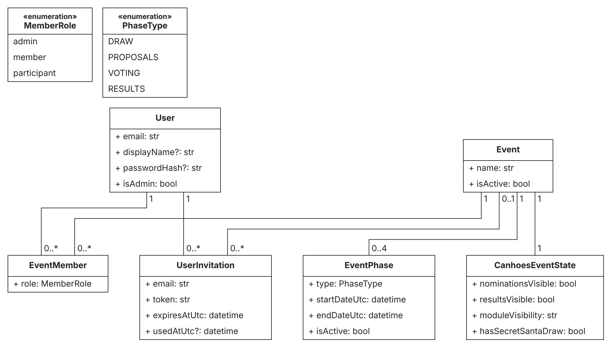
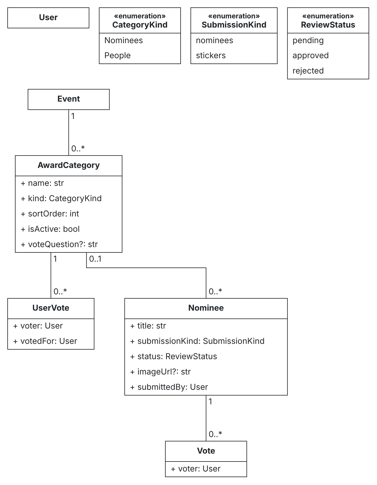
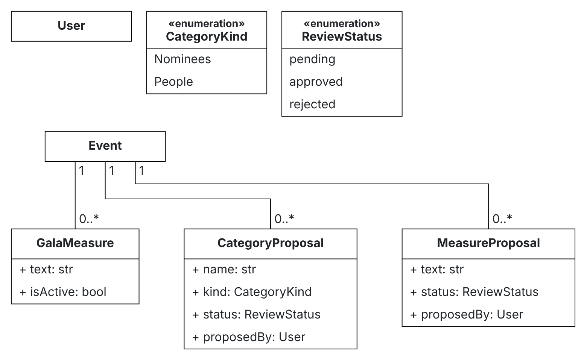
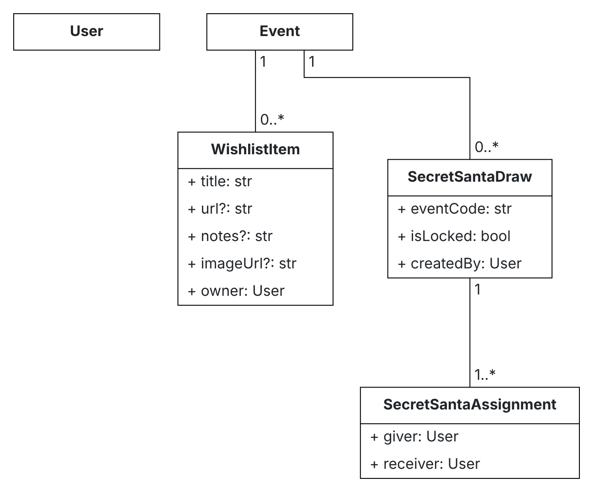
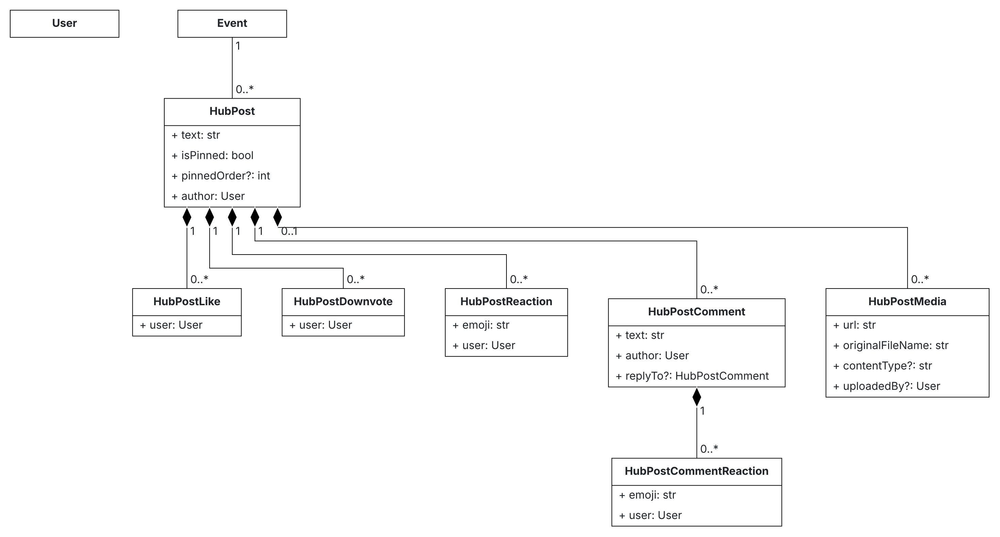
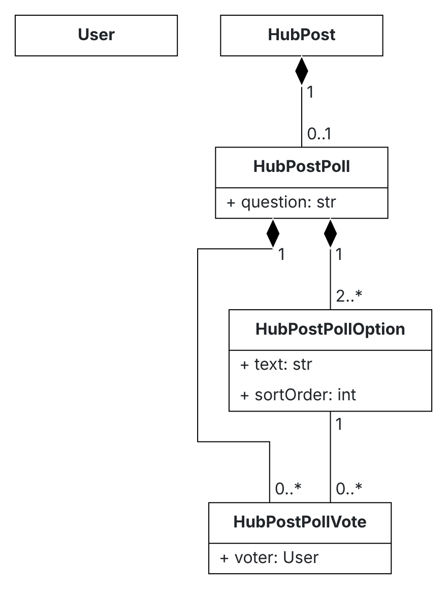

# 4. Modelo de dados

A fonte de verdade é `prisma/schema.prisma`; as alterações entram por migrations em `prisma/migrations`. As tabelas e colunas têm nomes em PascalCase (`Users`, `EventId`) porque o esquema veio de um backend .NET; no código usam-se os nomes camelCase do Prisma.

## Diagramas de classes

Há um diagrama por área, cada um com poucas classes. Foram feitos no [BESSER Web Modeling Editor](https://editor.besser-pearl.org); o JSON ao lado de cada imagem abre-se no editor para os alterar (ver [diagramas/README.md](diagramas/README.md)).

Como ler:

- Uma linha simples é uma ligação que só existe no código: a tabela guarda o id, sem chave estrangeira.
- Um losango cheio é uma chave estrangeira real com `onDelete: Cascade`; só o mural as tem.
- Um atributo do tipo `User` é o id de uma pessoa (`userId`, `proposedByUserId`, …). Fica como atributo para os diagramas não se encherem de linhas para a mesma caixa.
- `?` marca um campo opcional. As enumerações mostram os valores que o código aceita; na base de dados são strings ou inteiros (ver [Valores possíveis](#valores-possíveis)).

### Pessoas e eventos

Quem entra, a que evento pertence e em que fase o evento está.

### Categorias e votos

Uma categoria tem nomeações (votos em momentos, `kind = 0`) ou votos diretos em pessoas (`kind = 1`).

### Propostas e medidas

O que os membros propõem na fase PROPOSALS e o admin aprova.

### Amigo secreto e wishlist

`SecretSantaDraw.eventCode` liga o sorteio ao evento através de `CanhoesEventState.secretSantaEventCode`.

### Mural

### Sondagens do mural

### Encontros e locais

Organização de jantares/encontros da edição: votação de datas, RSVPs e sugestão/favoritos de restaurantes e locais.

## Tabelas

| Modelo (tabela) | Para quê | Unicidade relevante |
|---|---|---|
| `User` (`Users`) | Uma pessoa. `externalId` é o id do Google, `credentials:<email>` ou `seed:<email>`. `color` é a cor da pessoa (chave de `lib/personColors.ts`): sorteada ao criar a conta, a pessoa muda-a no menu. | `email`, `externalId` |
| `UserInvitation` (`UserInvitations`) | Convite pendente ou usado para um email, com papel atribuído e evento a que dá acesso. | `email`, `token` |
| `Event` (`Events`) | Uma edição dos Canhões. | |
| `EventMember` (`EventMembers`) | Quem pertence a um evento (`ADMIN` ou `PARTICIPANT`). | `(eventId, userId)` |
| `EventPhase` (`EventPhases`) | As fases de um evento, com datas; só uma está ativa (fonte de verdade de fase). | `(eventId, type)` |
| `CanhoesEventState` (`CanhoesEventState`) | Interruptores do admin por evento: visibilidade das nomeações e dos módulos, e o estado do sorteio. | `eventId` |
| `AwardCategory` (`AwardCategories`) | Uma categoria de prémio (`kind = 0` para nomeados, `kind = 1` para pessoas). | |
| `Nominee` (`Nominees`) | Uma nomeação ou sticker proposto por um membro. | |
| `Vote` (`Votes`) | Voto numa categoria. Modelo unificado: suporta tanto votos em nomeados (`nomineeId`) como votos diretos em pessoas (`targetUserId`). | `(categoryId, userId)` |
| `CategoryProposal` (`CategoryProposals`) | Proposta de categoria nova. | |
| `GalaMeasure` (`Measures`) | Medida oficial da gala. | |
| `MeasureProposal` (`MeasureProposals`) | Proposta de medida. | |
| `WishlistItem` (`WishlistItems`) | Desejo de um membro num evento. | |
| `SecretSantaDraw` (`SecretSantaDraws`) | Um sorteio; `isLocked` significa revelado. | |
| `SecretSantaAssignment` (`SecretSantaAssignments`) | Um par "quem dá → a quem". | |
| `Gathering` (`Gatherings`) | Encontro/jantar de grupo associado à edição. | |
| `GatheringDateOption` (`GatheringDateOptions`) | Datas propostas para o encontro. | |
| `GatheringDateVote` (`GatheringDateVotes`) | Votos dos membros nas datas propostas. | `(dateOptionId, userId)` |
| `GatheringRsvp` (`GatheringRsvps`) | Presenças confirmadas no encontro (`YES`, `NO`, `MAYBE`). | `(gatheringId, userId)` |
| `GatheringPlace` (`GatheringPlaces`) | Restaurantes e locais sugeridos para o evento/encontro. | |
| `PlaceFavorite` (`PlaceFavorites`) | Locais favoritos marcados pelos membros. | `(placeId, userId)` |
| `HubPost*` (`HubPosts`, …) | Mural: posts, imagens, sondagens, comentários, reações, likes, downvotes. | Um like, downvote e voto de sondagem por pessoa; uma reação por emoji por pessoa |

## Valores possíveis

O schema utiliza ENUMs nativos no PostgreSQL e Prisma (`EventMemberRole`, `PhaseType`, `ProposalStatus`, `NomineeSubmissionKind`, `GatheringStatus`, `RsvpStatus`).

| Campo | Valores | Notas |
|---|---|---|
| `EventPhase.type` | `DRAW`, `PROPOSALS`, `VOTING`, `RESULTS` | O tipo da fase ativa decide os módulos (RN-04). Única fonte de verdade para a fase do evento. |
| `EventMember.role`, `UserInvitation.role` | `ADMIN`, `PARTICIPANT` | Standardizado. Apenas `ADMIN` muda comportamento: não aparece como opção nas categorias de pessoa. As permissões de acesso ao painel vêm de `User.isAdmin`. |
| `AwardCategory.kind`, `CategoryProposal.kind` | `0` voto em nomeações, `1` voto em pessoas | `KindUserVote` em `lib/domains/admin/services/constants.ts` |
| `Nominee.status`, `CategoryProposal.status`, `MeasureProposal.status` | `pending`, `approved`, `rejected` | Só `approved` aparece aos membros e no boletim |
| `Nominee.submissionKind` | `nominees`, `stickers` | Os stickers são nomeações com este tipo |
| `CanhoesEventState.moduleVisibilityJson` | `{ "<módulo>": boolean }` | Uma chave em falta conta como ligada |
| `Gathering.status` | `DRAFT`, `DATE_VOTING`, `SCHEDULED`, `COMPLETED`, `CANCELLED` | Ciclo de vida de um encontro |
| `GatheringRsvp.response` | `YES`, `NO`, `MAYBE` | Intenção de presença do membro |
| `SecretSantaDraw.eventCode` | Por omissão o id do evento | Liga o sorteio ao evento através de `CanhoesEventState.secretSantaEventCode` |

## Datas e identificadores

- Todas as datas são `timestamptz` em UTC; os campos terminam em `Utc`.
- Os ids são UUIDs gerados pela base de dados, exceto `CanhoesEventState.id` (inteiro) e o id do evento do seed (`canhoes-local`).
- Os ficheiros enviados guardam o URL público (`/uploads/<pasta>/<nome>`) em `imageUrl`, `mediaUrl` e `HubPostMedia.url`.
