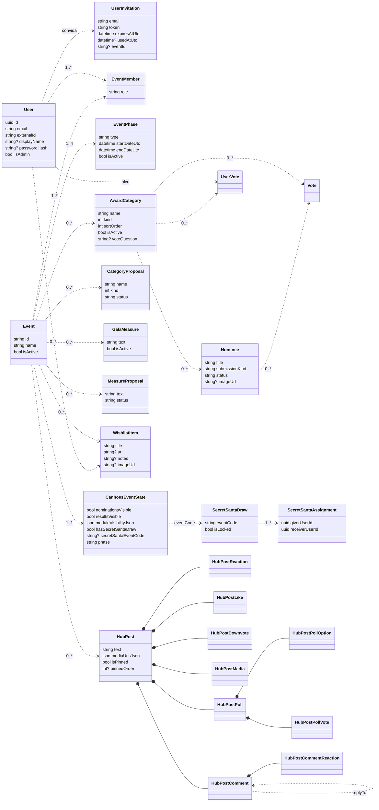

# 4. Modelo de dados

A fonte de verdade é `prisma/schema.prisma`; as alterações entram por migrations em `prisma/migrations`. As tabelas e colunas têm nomes em PascalCase (`Users`, `EventId`) porque o esquema veio de um backend .NET; no código usam-se os nomes camelCase do Prisma.

## Diagrama de classes

Setas a tracejado são ligações que só existem no código (IDs sem chave estrangeira). Losangos cheios são chaves estrangeiras reais com `onDelete: Cascade`; só o mural as tem.

## Tabelas

| Modelo (tabela) | Para quê | Unicidade relevante |
|---|---|---|
| `User` (`Users`) | Uma pessoa. `externalId` é o id do Google, `credentials:<email>` ou `seed:<email>`. | `email`, `externalId` |
| `UserInvitation` (`UserInvitations`) | Convite pendente ou usado para um email, com o evento a que dá acesso. | `email`, `token` |
| `Event` (`Events`) | Uma edição dos Canhões. | |
| `EventMember` (`EventMembers`) | Quem pertence a um evento. | `(eventId, userId)` |
| `EventPhase` (`EventPhases`) | As fases de um evento, com datas; só uma está ativa. | `(eventId, type)` |
| `CanhoesEventState` (`CanhoesEventState`) | Interruptores do admin por evento: visibilidade das nomeações e dos módulos, e o estado do sorteio. | `eventId` |
| `AwardCategory` (`AwardCategories`) | Uma categoria de prémio. | |
| `Nominee` (`Nominees`) | Uma nomeação ou sticker proposto por um membro. | |
| `Vote` (`Votes`) | Voto numa nomeação (categorias `kind = 0`). | `(categoryId, userId)` |
| `UserVote` (`UserVotes`) | Voto numa pessoa (categorias `kind = 1`). | `(categoryId, voterUserId)` |
| `CategoryProposal` (`CategoryProposals`) | Proposta de categoria nova. | |
| `GalaMeasure` (`Measures`) | Medida oficial da gala. | |
| `MeasureProposal` (`MeasureProposals`) | Proposta de medida. | |
| `WishlistItem` (`WishlistItems`) | Desejo de um membro num evento. | |
| `SecretSantaDraw` (`SecretSantaDraws`) | Um sorteio; `isLocked` significa revelado. | |
| `SecretSantaAssignment` (`SecretSantaAssignments`) | Um par "quem dá → a quem". | |
| `HubPost*` (`HubPosts`, …) | Mural: posts, imagens, sondagens, comentários, reações, likes, downvotes. | Um like, downvote e voto de sondagem por pessoa; uma reação por emoji por pessoa |

## Valores possíveis

O schema guarda estes estados como strings ou inteiros, sem enum na base de dados (a Fase 3 do plano troca-os por enums).

| Campo | Valores | Notas |
|---|---|---|
| `EventPhase.type` | `DRAW`, `PROPOSALS`, `VOTING`, `RESULTS` | O tipo da fase ativa decide os módulos (RN-04) |
| `EventMember.role` | `admin`, `member`, `participant` | Convites criam `participant`; o seed cria `member`. Só `admin` muda alguma coisa: não aparece como opção nas categorias de pessoa. As permissões de admin vêm de `User.isAdmin`, não deste campo. |
| `AwardCategory.kind`, `CategoryProposal.kind` | `0` voto em nomeações, `1` voto em pessoas | `KindUserVote` em `lib/domains/admin/services/constants.ts` |
| `Nominee.status`, `CategoryProposal.status`, `MeasureProposal.status` | `pending`, `approved`, `rejected` | Só `approved` aparece aos membros e no boletim |
| `Nominee.submissionKind` | `nominees`, `stickers` | Os stickers são nomeações com este tipo |
| `CanhoesEventState.moduleVisibilityJson` | `{ "<módulo>": boolean }` | Uma chave em falta conta como ligada |
| `CanhoesEventState.phase` | `locked`, `nominations`, `voting`, `gala` | Legado: é escrito ao mudar de fase mas nenhuma regra o lê; a fase verdadeira é a `EventPhase` ativa |
| `SecretSantaDraw.eventCode` | Por omissão o id do evento | Liga o sorteio ao evento através de `CanhoesEventState.secretSantaEventCode` |

## Datas e identificadores

- Todas as datas são `timestamptz` em UTC; os campos terminam em `Utc`.
- Os ids são UUIDs gerados pela base de dados, exceto `CanhoesEventState.id` (inteiro) e o id do evento do seed (`canhoes-local`).
- Os ficheiros enviados guardam o URL público (`/uploads/<pasta>/<nome>`) em `imageUrl`, `mediaUrl` e `HubPostMedia.url`.
