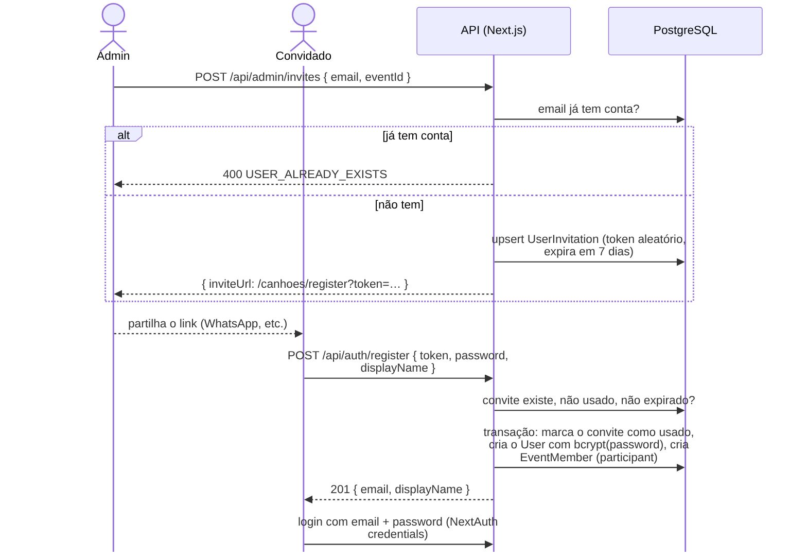
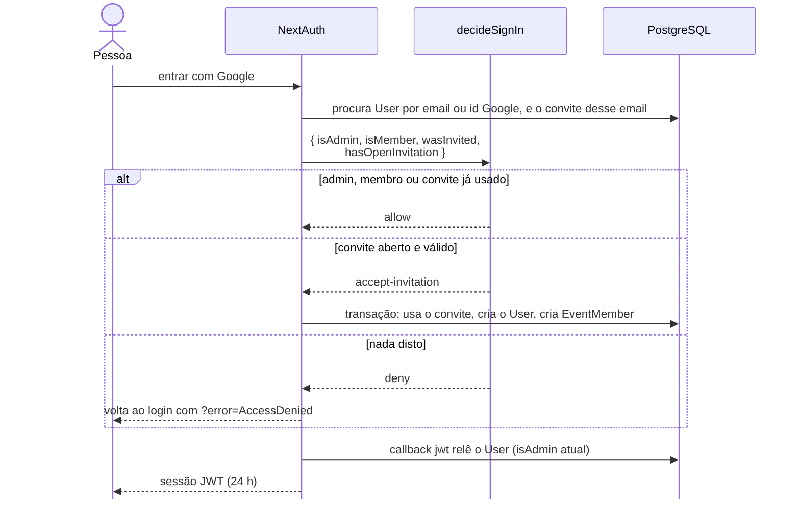
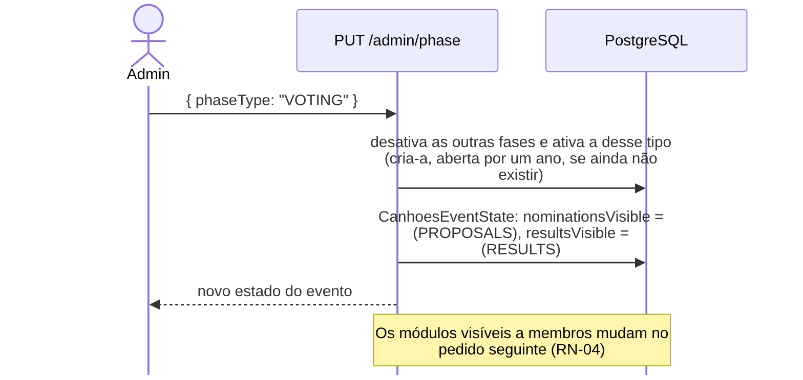
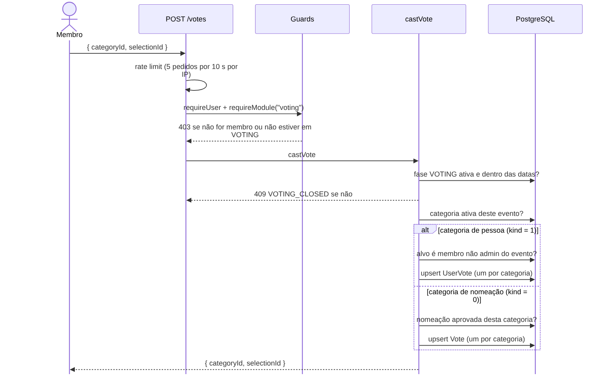
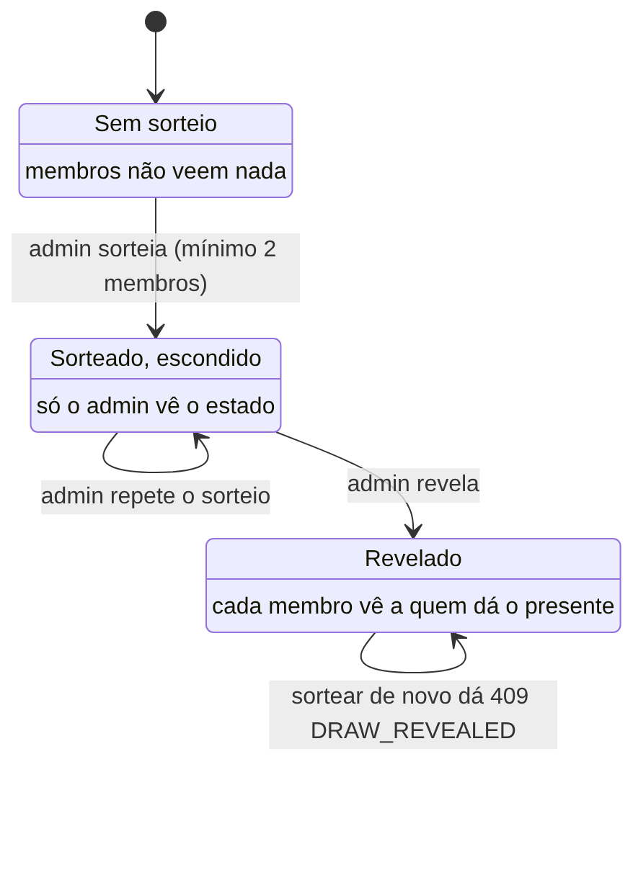
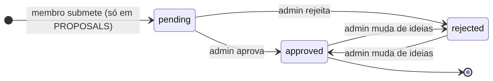
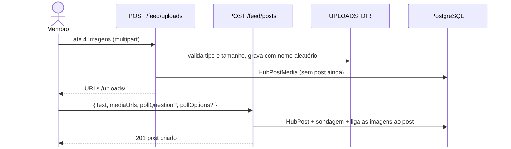

# 5. Fluxos principais

## Convite e registo com password

O admin cria o convite e partilha o link à mão; a app não envia emails.

## Login com Google

## Mudança de fase

O admin muda a fase no painel; não há mudanças automáticas por data.

## Votar

## Amigo secreto

O algoritmo (`lib/domains/secretSanta/services/draw.ts`) baralha os membros com Fisher-Yates e liga cada um ao seguinte, o último ao primeiro. Isso forma um único ciclo: ninguém tira o próprio nome e não há grupos fechados.

## Ciclo de vida de uma proposta ou nomeação

Vale para nomeações, stickers, propostas de categoria e propostas de medida.

Ao aprovar uma proposta de categoria ou de medida, a app cria a `AwardCategory` ou a `GalaMeasure` correspondente, só na primeira aprovação. Ao aprovar uma nomeação, ela passa a aparecer na página de nomeações e no boletim da sua categoria.

## Publicar no mural com imagens

