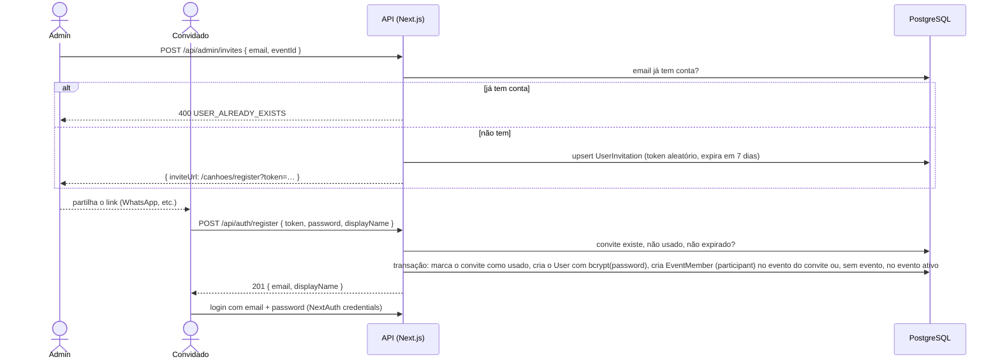
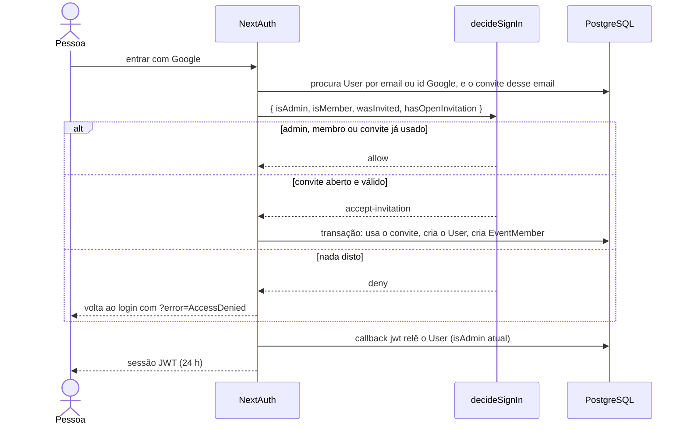
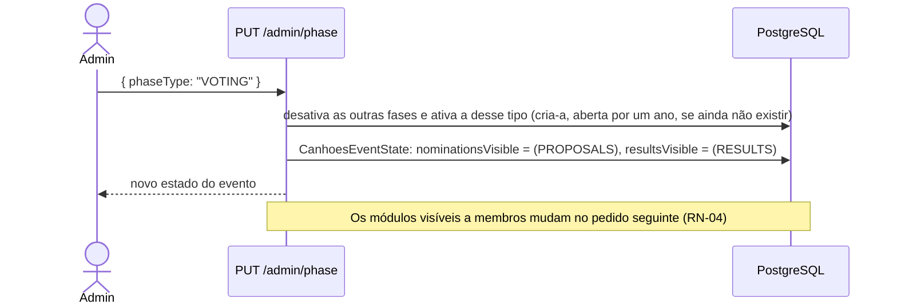
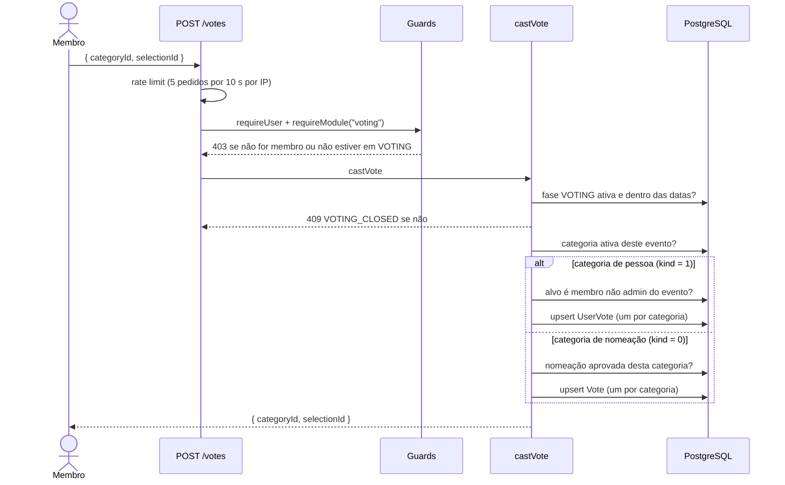
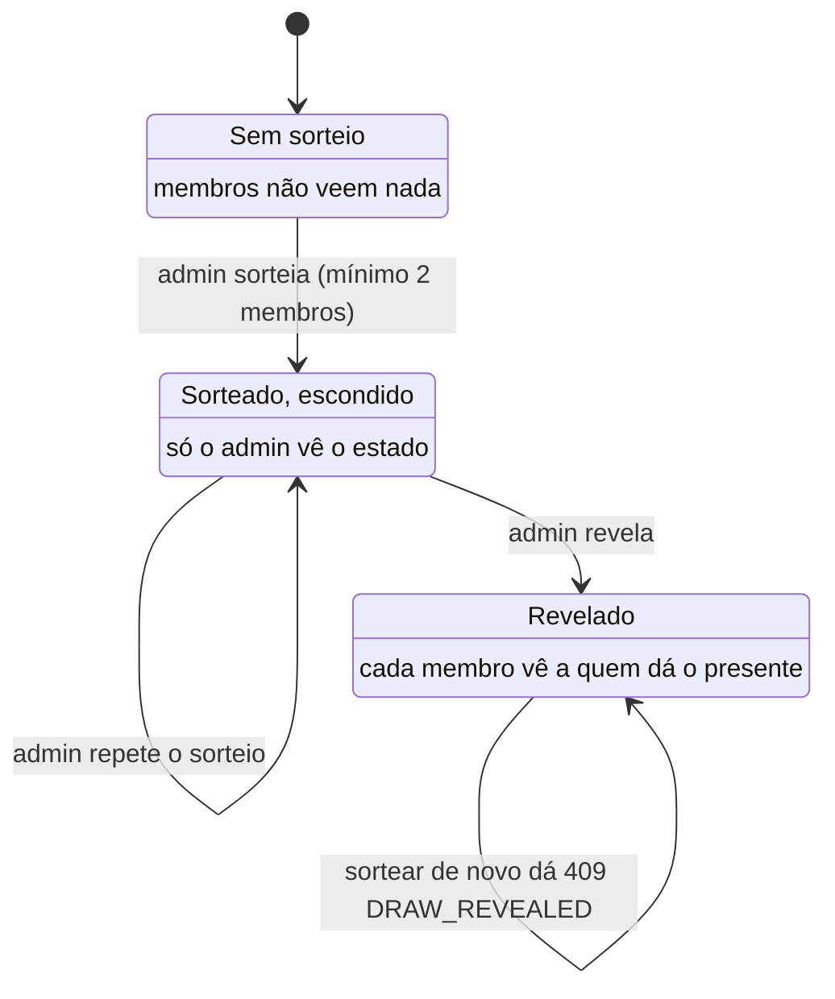
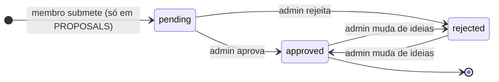
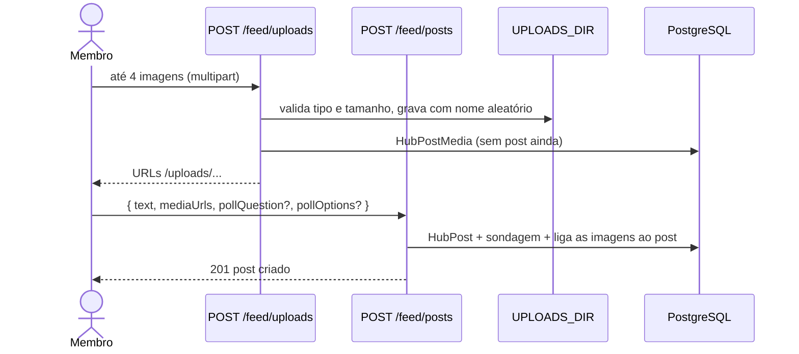
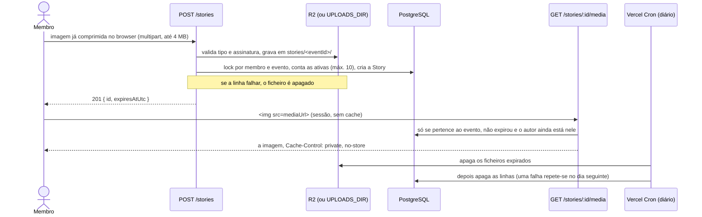

# 5. Fluxos principais

## Convite e registo com password

O admin cria o convite e partilha o link à mão; a app não envia emails.

## Login com Google

## Mudança de fase

O admin muda a fase no painel; não há mudanças automáticas por data.

## Votar

## Amigo secreto

O algoritmo (`lib/domains/secretSanta/services/draw.ts`) baralha os membros com Fisher-Yates e liga cada um ao seguinte, o último ao primeiro. Isso forma um único ciclo: ninguém tira o próprio nome e não há grupos fechados.

## Ciclo de vida de uma proposta ou nomeação

Vale para nomeações, stickers, propostas de categoria e propostas de medida.

Ao aprovar uma proposta de categoria ou de medida, a app cria a `AwardCategory` ou a `GalaMeasure` correspondente, só na primeira aprovação. Ao aprovar uma nomeação, ela passa a aparecer na página de nomeações e no boletim da sua categoria.

## Publicar no mural com imagens

## Stories de 24 horas

A faixa de stories do mural mostra o grupo todo: primeiro quem tem stories (com um anel na sua cor), depois os restantes membros. O visualizador avança sozinho a cada 5 segundos, exceto com `prefers-reduced-motion`, em que só avança ao tocar. No telemóvel: tocar à esquerda volta e à direita avança; premir e manter pára a story e esconde o topo (largar retoma); deslizar para baixo fecha (o ecrã acompanha o dedo); deslizar para os lados salta para o membro seguinte ou anterior. `/uploads/stories/*` devolve 404: a imagem só se vê pela rota do evento.

No cliente, a lista de stories atualiza-se de 3 em 3 minutos e quando o separador volta a ser visto. Antes de enviar, a imagem é sempre recodificada no navegador (WebP ou JPEG, lado maior até 1600 px), o que tira os metadados da foto (GPS, EXIF); se o navegador não conseguir, a story não se publica, em vez de enviar o original. Os GIF são recusados. O envio tem um limite de 60 segundos. Ao publicar, saem também as stories já expiradas do próprio autor, para que instalações sem cron (Docker, local) não acumulem ficheiros dele.
