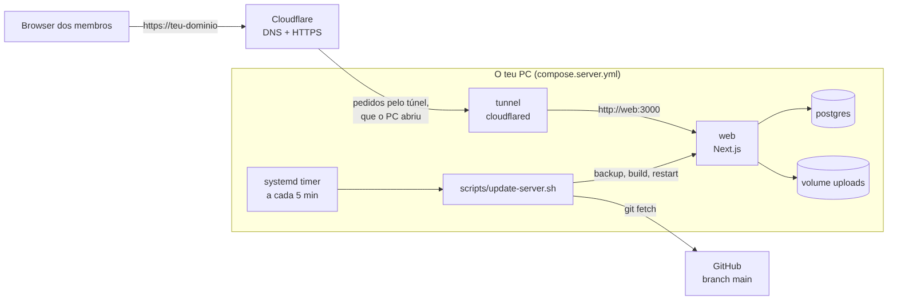

# 9. Deploy: o site no teu PC, com domínio próprio

O site corre no teu PC em contentores (Docker ou Podman) e fica público no teu domínio, com HTTPS, através de um **Cloudflare Tunnel**. O túnel é gratuito e é o próprio PC que abre a ligação para o Cloudflare. Por isso não abres portas no router e não precisas de IP fixo. Quando fazes merge de um PR para `main`, o PC instala a nova versão sozinho em menos de 5 minutos.

O único custo é o domínio. O site só está online enquanto o PC estiver ligado; a [última secção](#alternativa-sempre-online) explica como passar a mesma configuração para um servidor que nunca desliga.



## Ficheiros envolvidos

| Ficheiro | Para quê |
|---|---|
| `compose.server.yml` | A stack de produção: `postgres`, `web` e `tunnel` (cloudflared). Usa nomes, volumes e portas diferentes do `docker-compose.yml` de desenvolvimento, por isso as duas podem existir no mesmo PC |
| `.env.server.example` | Modelo do `.env.server`, que fica só no PC e tem as passwords e o token do túnel |
| `scripts/update-server.sh` | Faz o deploy: busca `main`, faz backup da base de dados, reconstrói, reinicia e espera pelo `/api/health` |
| `deploy/systemd/canhoes-update.{service,timer}` | Correm o script a cada 5 minutos e 2 minutos depois de o PC arrancar |

O job "Home server deploy" da CI corre o script duas vezes numa máquina limpa (instalação e redeploy com backup), por isso uma alteração que o parta não chega ao `main` com a CI verde.

## 1. Comprar o domínio

Preços para o primeiro ano e para a renovação, em dólares:

| Opção | 1.º ano | Renovação | Nota |
|---|---|---|---|
| `.top` na Porkbun | 1,63 | 4,63 | O mais barato nos dois anos |
| `.xyz` na Porkbun | 2,04 | 14,21 | Barato só no primeiro ano |
| `.com` no Cloudflare Registrar | 10,46 | 10,46 | Preço de custo, sem promoções; dispensa o passo dos nameservers |

Fontes: [preços da Porkbun](https://www.best-domain-registrars.com/registrars/porkbun/pricing/) (vistos a 28/09/2026) e [preço do `.com` no Cloudflare](https://domainoffer.net/tld/com/cloudflare) (visto a 15/10/2026). Confirma o valor final no carrinho antes de pagar.

**Recomendação:** um `.top` na Porkbun se o objetivo é só ter o domínio um ano ao menor custo. Se o quiseres manter vários anos com um nome mais comum, um `.com` no Cloudflare.

Se compraste fora do Cloudflare, liga o domínio ao Cloudflare (plano Free, grátis):

1. No [dashboard do Cloudflare](https://dash.cloudflare.com/), **Add a domain**, escreve o domínio e escolhe o plano **Free**.
2. O Cloudflare mostra dois nameservers. Na Porkbun, em **Domain Management → Authoritative Nameservers**, troca os nameservers da Porkbun por esses dois.
3. Espera que o Cloudflare marque o domínio como **Active**. Costuma demorar minutos, mas pode levar até 24 h.

## 2. Criar o túnel

1. No dashboard do Cloudflare, abre **Zero Trust → Networks → Tunnels** e cria um túnel do tipo **Cloudflared** com o nome `canhoes`.
2. No ecrã de instalação, copia só o token: a sequência longa que aparece depois de `--token` no comando de exemplo. Não precisas de instalar nada a partir daí, porque o contentor `tunnel` faz isso.
3. Adiciona uma rota pública (**Public Hostname** ou **Published application route**):
   - Domínio: o teu, sem subdomínio, ou com um, como `canhoes`.
   - Tipo de serviço: **HTTP**.
   - URL: `web:3000`. É o nome do serviço dentro do `compose.server.yml`, não um endereço do PC.

## 3. Preparar o PC

O guia assume Linux. Precisas de `git`, `curl` e de Docker ou Podman. Com Podman, instala também o `podman-compose` (`sudo dnf install podman-compose`).

**Acesso ao repositório.** Se o repositório for público, basta `git clone https://github.com/joaopachecowork1/Canhoes.git ~/canhoes-server`. Se for privado, cria uma chave só de leitura para este PC:

```bash
ssh-keygen -t ed25519 -f ~/.ssh/canhoes_deploy -N ""
cat ~/.ssh/canhoes_deploy.pub   # cola em GitHub → Settings → Deploy keys → Add deploy key (sem "Allow write access")
```

Depois, em `~/.ssh/config`:

```
Host github-canhoes
  HostName github.com
  User git
  IdentityFile ~/.ssh/canhoes_deploy
  IdentitiesOnly yes
```

E clona:

```bash
git clone github-canhoes:joaopachecowork1/Canhoes.git ~/canhoes-server
```

Usa uma pasta só para o servidor (`~/canhoes-server`), separada da pasta onde programas. O script recusa atualizar uma pasta com alterações locais.

**Configuração.**

```bash
cd ~/canhoes-server
cp .env.server.example .env.server
openssl rand -hex 24      # → POSTGRES_PASSWORD
openssl rand -base64 32   # → NEXTAUTH_SECRET
```

Preenche o `.env.server`:

- `NEXTAUTH_URL`: o endereço público, como `https://canhoes.top`.
- `ADMIN_EMAILS`: o teu email.
- `CLOUDFLARE_TUNNEL_TOKEN`: o token do passo 2.
- Credenciais Google: na [Google Cloud Console](https://console.cloud.google.com/apis/credentials), no cliente OAuth, acrescenta `https://<domínio>/api/auth/callback/google` aos **Authorized redirect URIs** e `https://<domínio>` às **Authorized JavaScript origins**.

## 4. Primeiro arranque

```bash
cd ~/canhoes-server
scripts/update-server.sh --force
```

O primeiro build demora alguns minutos. No fim, o script diz `App is healthy on this machine` e, se o túnel e o DNS já estiverem prontos, `Public site is up`. Abre o domínio, entra com Google com o email de `ADMIN_EMAILS` e convida o resto do grupo no painel de admin.

## 5. Atualizações automáticas

```bash
mkdir -p ~/.config/systemd/user
cp ~/canhoes-server/deploy/systemd/canhoes-update.* ~/.config/systemd/user/
systemctl --user daemon-reload
systemctl --user enable --now canhoes-update.timer
loginctl enable-linger "$USER"   # o timer corre mesmo sem sessão iniciada
```

Os contentores também têm de voltar sozinhos depois de reiniciar o PC:

- **Docker:** `sudo systemctl enable --now docker`, e o teu utilizador no grupo `docker` (`sudo usermod -aG docker $USER`, depois termina a sessão e volta a entrar).
- **Podman:** `systemctl --user enable podman-restart.service`.

A partir daqui, o ciclo é:

1. Fazes um PR.
2. A CI fica verde.
3. Fazes merge para `main`.
4. Em menos de 5 minutos o PC faz backup da base de dados, reconstrói e reinicia.

Para acompanhar:

```bash
systemctl --user list-timers canhoes-update.timer   # próxima verificação
journalctl --user -u canhoes-update -f              # o que cada deploy fez
```

Se um deploy falhar no build, a versão anterior continua a correr. O script não tenta outra vez a mesma versão: corrige em `main` (o próximo merge volta a disparar o deploy) ou corre `scripts/update-server.sh --force`.

**Voltar atrás:** reverte o PR no GitHub (botão **Revert**) e faz merge da reversão; o PC instala-a como qualquer outra versão. Se a versão má tinha uma migration, restaura também o backup feito antes dela (ver abaixo).

## 6. Backups

Cada deploy guarda antes um `pg_dump` em `~/canhoes-server/backups/` e mantém os 20 mais recentes. Copia de vez em quando essa pasta para fora do PC, por exemplo para uma pasta sincronizada com a cloud.

Nos comandos abaixo, troca `docker` por `podman` se for o teu caso.

```bash
cd ~/canhoes-server

# Backup manual da base de dados
docker exec canhoes-server-postgres pg_dump -U canhoes -d canhoes -Fc > backups/manual.dump

# Restaurar um backup (substitui os dados atuais)
docker cp backups/<ficheiro>.dump canhoes-server-postgres:/tmp/restore.dump
docker exec canhoes-server-postgres pg_restore --clean --if-exists --no-owner -U canhoes -d canhoes /tmp/restore.dump

# Backup das imagens enviadas (volume uploads)
docker run --rm -v canhoes-server_uploads:/data:ro -v "$PWD/backups:/backup" docker.io/library/alpine \
  tar czf /backup/uploads.tgz -C /data .
```

## 7. Problemas comuns

| Sintoma | Causa provável | O que fazer |
|---|---|---|
| Página do Cloudflare com erro 1033 ou 502 | PC desligado, túnel em baixo ou `web` parado | `docker logs canhoes-server-tunnel` e `journalctl --user -u canhoes-update` |
| Google responde `redirect_uri_mismatch` | Falta o redirect URI do domínio na Google | Passo 3, credenciais Google |
| O login volta sempre ao início | `NEXTAUTH_URL` não é exatamente o endereço público (https, sem barra no fim) | Corrige no `.env.server` e corre `scripts/update-server.sh --force` |
| `web` não arranca: password errada para `canhoes` | `POSTGRES_PASSWORD` mudou depois do primeiro arranque; a base de dados guarda a original | Repõe a original ou muda-a dentro do PostgreSQL com `ALTER USER canhoes PASSWORD '...'` |
| O site cai quando o PC adormece | Suspensão automática | Desliga a suspensão nas definições de energia |

## Desenvolver no mesmo PC

As duas stacks podem correr ao mesmo tempo:

| | Desenvolvimento | Servidor |
|---|---|---|
| Ficheiro | `docker-compose.yml` | `compose.server.yml` |
| Pasta | a tua pasta de trabalho | `~/canhoes-server` |
| Contentores | `canhoes-postgres`, `canhoes-web` | `canhoes-server-postgres`, `canhoes-server-web`, `canhoes-server-tunnel` |
| Portas no PC | PostgreSQL 5433, app 3000 | Só a app, em `127.0.0.1:3100` |
| Dados | volumes `canhoes_*` (dados de demonstração) | volumes `canhoes-server_*` (dados reais) |

## Alternativa sempre online

Para o site não depender do PC, a mesma pasta corre sem alterações num servidor Linux alugado. Um Hetzner CX23 (2 vCPU, 4 GB) custa cerca de 4,49 € por mês. Repete os passos 3 a 6 nesse servidor com o mesmo `.env.server`, e restaura lá o último backup.

Antes de o ligar, para a stack do PC: `docker compose -p canhoes-server -f compose.server.yml --env-file .env.server down`. Dois conectores com o mesmo token repartem os pedidos entre as duas máquinas, cada uma com a sua base de dados.
